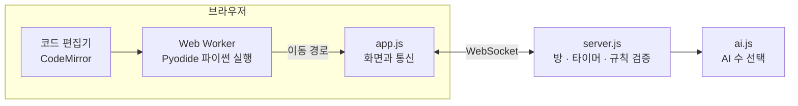

<div align="center">


# 파이썬 오목

**마우스 클릭 대신 파이썬 코드로 돌을 두는 오목 게임**

`print("돌")`로 돌을 만들고, 반복문과 조건문으로 옮기고, `place()`로 놓습니다.


[](https://render.com/deploy?repo=https://github.com/kimmj1234/python-omok)

</div>


## 왜 만들었나요

문법을 처음 배울 때 가장 어려운 점은 **배운 걸 써먹을 이유가 없다**는 것입니다. 오목은 규칙을 누구나 알고, 한 수마다 "저 칸까지 어떻게 옮기지?"라는 작은 문제가 생깁니다. 이기고 싶어서 `for`와 `if`를 쓰게 되는 게임을 목표로 했습니다.

## 어떻게 두나요

```python
print("돌")                    # 1-1 에 임시 돌이 생겨요

while get_x() < 10:            # 가로 10번째 칸에 닿을 때까지
    if blocked("right"):       # 바로 앞이 막혔으면
        jump("right")          # 이어진 돌을 건너뛰고
    else:
        right()                # 아니면 한 칸 이동

place()                        # 지금 자리에 진짜로 놓기
```

`place()` 없이 실행하면 임시 돌과 이동 경로만 미리 보여 줍니다.

## 주요 기능

| 기능 | 내용 |
|---|---|
| **8단계 학습** | `print`부터 `for`, `if`/`else`, `while`을 거쳐 오목 완성까지 |
| **친구와 1:1** | 방을 만들고 링크를 보내면 바로 대결. 끊겨도 자동으로 다시 접속 |
| **AI 대결** | 쉬움 · 보통 · 어려움. AI도 사람과 똑같은 이동 규칙을 따름 |
| **한국어 에러 설명** | `NameError` 같은 파이썬 에러를 초보자용 한국어 문장으로 번역 |
| **설치 없음** | 파이썬이 브라우저 안에서 실행되어 링크만 열면 시작 |

| 학습 모드 | 대전 준비 |
|---|---|
|  |  |

## 구조



- **코드는 브라우저에서 실행합니다.** 다른 사람의 코드를 서버에서 돌릴 필요가 없어 서버가 안전합니다. 무한 반복은 5초 뒤 워커를 종료해 막습니다.
- **서버는 좌표를 믿지 않습니다.** 클라이언트는 `RRDD` 같은 이동 경로만 보내고, 서버가 1-1부터 직접 걸어 보며 규칙에 맞는지 검증합니다.
- **AI도 같은 길로 다닙니다.** 1-1에서 닿을 수 있는 칸을 BFS로 찾고, 사람의 수를 검증하는 함수로 똑같이 검증받습니다.

## 개발 과정

직접 플레이하고 피드백을 준 뒤 고치는 과정을 반복했습니다. 기능보다 **결정이 바뀐 순간**이 더 많은 걸 가르쳐 줘서, 그 순간들을 기록합니다.

### 1. 게임의 뼈대 잡기

왼쪽에 코드, 오른쪽에 바둑판을 두고 `print`로 돌을 만드는 구조에서 출발했습니다. 처음에는 `x = 1, y = 1`처럼 좌표를 지정하는 방식이었는데, 이건 코드를 배우는 게 아니라 좌표를 받아 적는 것이었습니다. 그래서 **돌은 항상 1-1에서 출발하고 코드로 걸어가는** 규칙으로 바꿨습니다.

### 2. 직접 대국하다 발견한 교착 상태

두 플레이어의 코드를 번갈아 입력하며 실제 대국을 테스트하자 문제가 나왔습니다. 1-1 주변이 돌로 막히면 **둘 곳이 있어도 갈 수가 없었습니다.**

- 해결: 이어진 돌을 건너뛰는 `jump()`를 추가했습니다.
- 결과: 닿을 수 없는 칸이 44~64개에서 6~7개로 줄었습니다.
- 그래도 완전히 갇히면 시간 초과 패배 대신 **무승부**로 끝나게 했습니다.

### 3. "그건 좌표 찍기잖아요"

코드를 쉽게 만들려고 `goto(x, y)`와 `right(7)`을 넣었더니 짧아지긴 했지만, 반복문과 조건문을 쓸 이유가 사라졌습니다. 편의 기능이 게임의 목적을 없앤 것입니다. 전부 되돌리고 **한 칸 이동과 `for`, `if`, `while`만으로 충분한 난이도**를 다시 맞췄습니다. 대전 중에는 둘 자리를 알려 주는 힌트도 금지하고, 코드 작성 팁만 남겼습니다.

### 4. 초보자는 어디서 막히나

- 맞는 코드를 썼는데 돌이 안 놓여서 "이 코드가 틀려?" 싶은 순간이 있었습니다. 서버가 꺼져 있는데도 "놓았어요"라고 표시했기 때문입니다. 이제 **서버가 확인한 뒤에만** 성공 메시지를 보여 줍니다.
- 영어 에러 메시지를 약 60가지 경우로 나눠 시험하며 한국어로 옮겼습니다.
- `right` 뒤에 괄호를 빠뜨리면 에러 없이 아무 일도 안 일어나는 파이썬 특성을 잡아 알려 줍니다.

### 5. AI 대결, 그리고 이름값 못 하는 "어려움"

처음 만든 어려움 AI를 보통과 대결시키자 **11승 7패 12무**로 차이가 거의 없었습니다. "막을 수 없는 수"를 따지도록 고쳐도 비슷해서, 몇 수 앞을 읽는 알파-베타 탐색으로 다시 만들었습니다. 난이도 이름을 믿지 않고 대국 결과로 확인한 덕분에 찾은 문제입니다.

| 대결 (각 30판) | 승 | 패 | 무 |
|---|---|---|---|
| 보통 vs 쉬움 | 30 | 0 | 0 |
| 어려움 vs 쉬움 | 30 | 0 | 0 |
| 어려움 vs 보통 | 17 | 7 | 6 |

AI에 무작위 요소가 있어 결과는 돌릴 때마다 조금씩 달라집니다. (다른 회차의 어려움 vs 보통: 15승 6패 9무)

### 6. 공개를 위한 마무리

이모티콘을 [Lucide](https://lucide.dev) 아이콘으로 바꾸고 로고를 만들었습니다. 로고의 점선 돌은 코드로 옮기는 중인 임시 돌입니다. 공개 서버를 대비해, 잘못된 주소 하나로 서버가 멈출 수 있던 문제도 고쳤습니다.

## 검증

```bash
npm test
```

- AI 규칙 시험: 이동 경로 약 79만 개가 서버 검증과 일치하고, 대국 중 규칙 위반 0건
- 봇끼리 543수 대국, 2개 탭으로 실제 화면에서 대국, 서버를 끄고 다시 켜는 시험

`npm test`에는 AI 규칙 시험만 들어 있고, 나머지는 개발 중에 직접 돌린 시험입니다.

## 아쉬운 점

- 서버를 다시 시작하면 방이 사라집니다. 방을 메모리에만 보관합니다.
- 휴대폰 화면은 아직 코드 입력이 불편합니다.
- 변수와 함수 만들기(`def`)는 학습 단계에 없습니다.
- 초보자가 정말 제한 시간 안에 코드를 쓸 수 있는지는 사람으로 시험해 보지 못했습니다.

## 실행하기

```bash
npm install
npm start
```

`http://localhost:3000`을 열면 됩니다. 같은 와이파이의 친구는 서버 시작 때 표시되는 주소로 들어올 수 있습니다.

## 만든 방법

기획, 규칙 결정, 플레이 피드백은 제가 맡고, 구현과 테스트는 AI 코딩 도구 [Claude Code](https://claude.com/claude-code)와 함께 진행했습니다.

아이콘: [Lucide](https://lucide.dev) (ISC 라이선스, `public/icons/LICENSE`)
